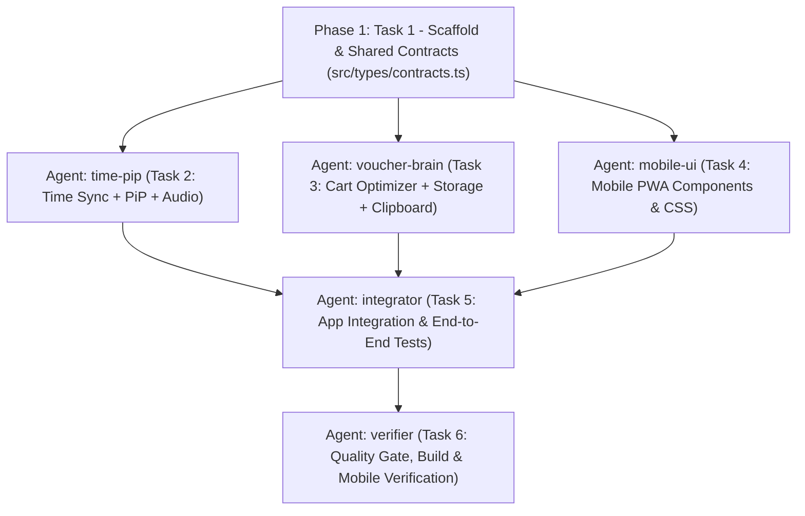

# Implementation Plan: Shopee 11/11 Manual-Assist Companion

## Overview

Xây dựng ứng dụng web di động (PWA) **ShoopeeTool** giúp người dùng chuẩn bị trước kịch bản đơn hàng – voucher, tối ưu gộp/tách giỏ hàng, copy sẵn mã 1 chạm và canh giờ mở mã chính xác đến `0.1 giây` thông qua cửa sổ nổi **Picture-in-Picture (PiP)** kèm âm báo nhịp trên điện thoại (100% hợp lệ, không auto-click hay can thiệp hệ thống Shopee).

## Architecture Decisions

1. **Zero-Collision Modular Architecture cho Multi-Agent (Swarm):**
   - Khóa cứng toàn bộ kiểu dữ liệu tại `src/types/contracts.ts` ngay ở **Phase 1 (Foundation)**.
   - Tách thành **3 nhánh độc lập hoàn toàn về file** ở **Phase 2** để điều phối 3 Gemini Agents làm việc song song không đụng độ:
     - `time-pip` phụ trách engine đồng bộ giờ chuẩn, Web Audio và Canvas Picture-in-Picture (`src/lib/timeSync.ts`, `src/lib/pipClock.ts`, `src/lib/audioCue.ts`).
     - `voucher-brain` phụ trách thuật toán ghép đơn – voucher, lưu trữ `localStorage` và copy/deep-link (`src/lib/optimizer.ts`, `src/lib/storage.ts`, `src/lib/clipboard.ts`).
     - `mobile-ui` phụ trách các React components và giao diện cảm ứng tối ưu 1 tay (`src/components/*`, `src/styles/global.css`).
2. **Kết hợp Canvas Stream + Audio Track cho PiP Mobile:**
   - Khi chuyển sang App Shopee, trình duyệt nền dễ bị đóng băng timer thường. Ghép `canvas.captureStream(30)` với `MediaStreamAudioDestinationNode` đưa vào thẻ `<video playsInline>` ở chế độ Picture-in-Picture giúp cả hình ảnh đồng hồ nổi `0.1s` lẫn tiếng *Bíp-Bíp-BẤM!* duy trì hoạt động ổn định.
3. **Fallback an toàn cho LAN HTTP & iOS Safari:**
   - Khi mở qua IP mạng LAN (`http://192.168.x.x:5173`), `navigator.clipboard` có thể bị chặn bởi trình duyệt di động → dùng fallback `<textarea>` ẩn + `execCommand('copy')`.
   - Khi trình duyệt từ chối `canvas.captureStream()` PiP → tự động chuyển sang chế độ **HUD Toàn Màn Hình Tương Phản Cao + Âm Báo Không Ngắt**.

## Gemini Agents Orchestration Plan (Swarm Topology)

Ngay sau khi kế hoạch được duyệt, Coordinator sẽ khởi tạo **Gemini Swarm** gồm các agent chuyên trách:

| Roster Name | Workspace | Quyền sở hữu File (Không chồng lấn) | Nhiệm vụ chính |
|---|---|---|---|
| `time-pip` | `share` | `src/lib/timeSync.ts`, `src/lib/pipClock.ts`, `src/lib/audioCue.ts`, `tests/timeSync.test.ts` | Đồng bộ giờ chuẩn bù RTT, state machine đếm ngược bù phản xạ (`leadMs`), render Canvas PiP & âm báo nhịp. |
| `voucher-brain` | `share` | `src/lib/optimizer.ts`, `src/lib/storage.ts`, `src/lib/clipboard.ts`, `tests/optimizer.test.ts` | Bộ giải bài toán gộp/tách giỏ hàng khớp điều kiện voucher, lưu kịch bản 11/11 vào `localStorage`, copy mã & mở Shopee. |
| `mobile-ui` | `share` | `src/components/*`, `src/styles/global.css` | Xây dựng giao diện PWA mobile-first tối ưu thao tác 1 tay, thẻ checklist trước giờ G, modal tính ghép đơn. |
| `integrator` | `share` | `src/App.tsx`, `public/manifest.webmanifest`, `tests/storage-ui.test.tsx` | Kết nối 3 nhánh vào `App.tsx`, viết integration tests luồng săn mã hoàn chỉnh. |
| `verifier` | `inherit` | *(Read-only & Test runner)* | Kiểm tra chéo toàn bộ code theo `SPEC.md`, chạy `npm run typecheck`, `npm test`, `npm run build` và rà soát lỗi biên mobile. |

## Task List

Chi tiết từng task được quản lý tại `tasks/todo.md`:

### Phase 1: Foundation
- [ ] Task 1: Khởi tạo dự án Vite + React + TypeScript + Vitest và định nghĩa `src/types/contracts.ts`

### Checkpoint: Foundation
- [ ] `npm run typecheck` và `npm test` chạy sạch trên khung dự án gốc

### Phase 2: Parallel Core Modules (Điều phối 3 Gemini Agents song song)
- [ ] Task 2 (`time-pip`): Xây dựng Engine đồng bộ giờ chuẩn, Âm báo nhịp & Cửa sổ nổi PiP + Unit Tests
- [ ] Task 3 (`voucher-brain`): Xây dựng Bộ tối ưu ghép đơn – voucher, Lưu trữ kịch bản & Clipboard LAN fallback + Unit Tests
- [ ] Task 4 (`mobile-ui`): Xây dựng bộ giao diện Mobile-First (LiveStrikeBar, RunbookList, RunbookForm, CartOptimizer)

### Checkpoint: Core Modules
- [ ] Toàn bộ unit tests của `timeSync` và `optimizer` pass, components biên dịch không lỗi kiểu

### Phase 3: Integration & Verification
- [ ] Task 5 (`integrator`): Tích hợp `App.tsx`, cấu hình PWA `manifest.webmanifest` & viết Integration Tests
- [ ] Task 6 (`verifier`): Kiểm định toàn diện chất lượng, build production & kiểm tra danh mục nghiệm thu `SPEC.md`

### Checkpoint: Complete
- [ ] Mọi tiêu chí nghiệm thu trong `SPEC.md` đạt 100%
- [ ] Sẵn sàng mở qua Wi-Fi cho điện thoại sử dụng ngay

## Risks and Mitigations

| Risk | Impact | Mitigation |
|------|--------|------------|
| Trình duyệt di động chặn Clipboard API khi mở qua IP LAN (`http://192.168.x.x`) | High | Viết hàm fallback tạo `<textarea readonly>` tạm thời và gọi `document.execCommand('copy')` ngay trong sự kiện chạm của người dùng. |
| Một số đời iOS Safari giới hạn `canvas.captureStream()` trong PiP | Medium | Kiểm tra khả năng hỗ trợ runtime (`document.pictureInPictureEnabled` / `webkitSupportsPresentationMode`), cung cấp chế độ HUD toàn màn hình + luồng Âm báo liên tục không phụ thuộc PiP. |
| Các API giờ chuẩn công cộng bị chặn CORS hoặc mạng chập chờn lúc 0h | Medium | Thử tuần tự nhiều nguồn CORS hợp lệ + lấy trung vị bù `RTT/2`, nếu mất mạng tự lùi về đồng hồ máy cộng thanh trượt tinh chỉnh tay `±2.0s`. |
| Xung đột file khi nhiều Gemini Agents cùng sửa code | High | Khóa `src/types/contracts.ts` từ Task 1 và phân vùng thư mục độc lập cho từng agent trên workspace riêng (`share`), chỉ merge sau khi pass kiểm tra kiểu. |

## Open Questions

- Xác nhận từ người dùng để kích hoạt dàn Gemini Agents thực thi theo đúng kế hoạch trên.
