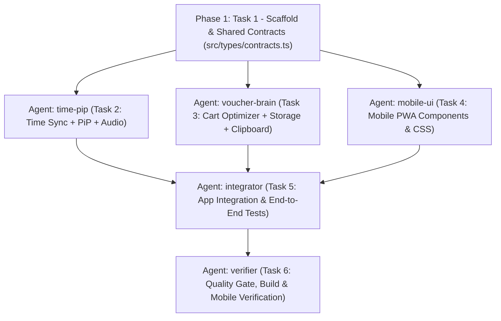
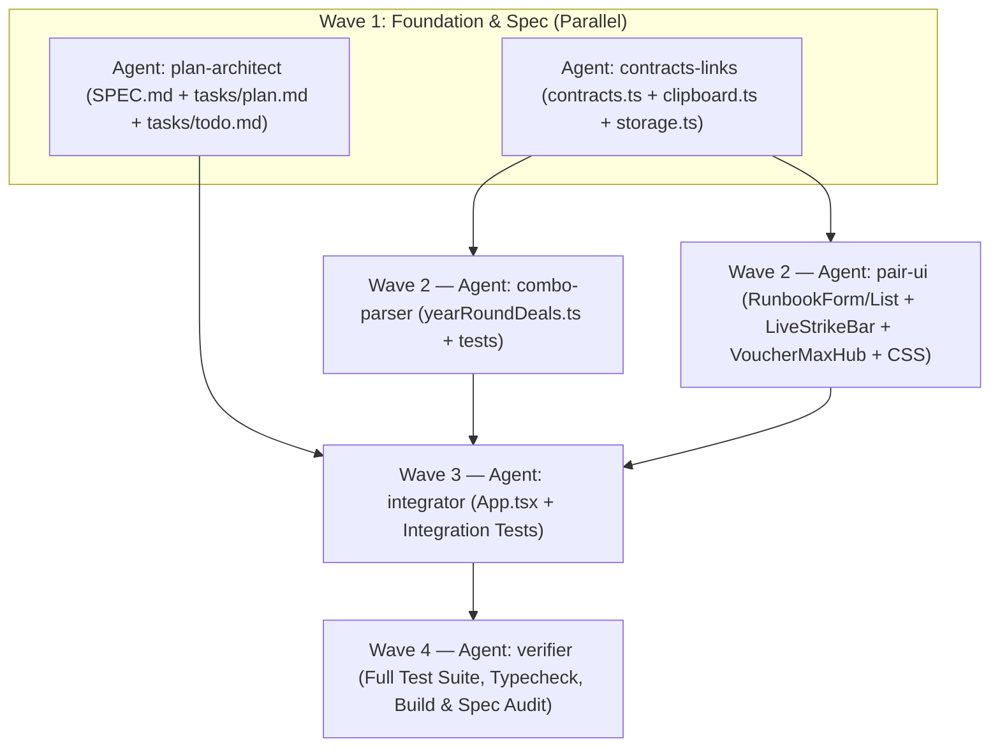

# Implementation Plan: Shopee 11/11 Manual-Assist Companion

## Overview

Xây dựng ứng dụng web di động (PWA) **ShoopeeTool** giúp người dùng chuẩn bị trước kịch bản đơn hàng – voucher, tối ưu gộp/tách giỏ hàng, copy sẵn mã 1 chạm và canh giờ mở mã chính xác đến `0.1 giây` thông qua cửa sổ nổi **Picture-in-Picture (PiP)** kèm âm báo nhịp trên điện thoại (100% hợp lệ, không auto-click hay can thiệp hệ thống Shopee).

## Architecture Decisions

1. **Zero-Collision Modular Architecture cho Multi-Agent (Swarm):**
   - Khóa cứng toàn bộ kiểu dữ liệu tại `src/types/contracts.ts` ngay ở **Phase 1 (Foundation)**.
   - Tách thành **3 nhánh độc lập hoàn toàn về file** ở **Phase 2** để điều phối 3 Gemini Agents làm việc song song không đụng độ:
     - `time-pip` phụ trách engine đồng bộ giờ chuẩn, Web Audio và Canvas Picture-in-Picture (`src/lib/timeSync.ts`, `src/lib/pipClock.ts`, `src/lib/audioCue.ts`).
     - `voucher-brain` phụ trách thuật toán ghép đơn – voucher, lưu trữ `localStorage` và copy/deep-link (`src/lib/optimizer.ts`, `src/lib/storage.ts`, `src/lib/clipboard.ts`).
     - `mobile-ui` phụ trách các React components và giao diện cảm ứng tối ưu 1 tay (`src/components/*`, `src/styles/global.css`).
2. **Kết hợp Canvas Stream + Audio Track cho PiP Mobile:**
   - Khi chuyển sang App Shopee, trình duyệt nền dễ bị đóng băng timer thường. Ghép `canvas.captureStream(30)` với `MediaStreamAudioDestinationNode` đưa vào thẻ `<video playsInline>` ở chế độ Picture-in-Picture giúp cả hình ảnh đồng hồ nổi `0.1s` lẫn tiếng *Bíp-Bíp-BẤM!* duy trì hoạt động ổn định.
3. **Fallback an toàn cho LAN HTTP & iOS Safari:**
   - Khi mở qua IP mạng LAN (`http://192.168.x.x:5173`), `navigator.clipboard` có thể bị chặn bởi trình duyệt di động → dùng fallback `<textarea>` ẩn + `execCommand('copy')`.
   - Khi trình duyệt từ chối `canvas.captureStream()` PiP → tự động chuyển sang chế độ **HUD Toàn Màn Hình Tương Phản Cao + Âm Báo Không Ngắt**.

## Gemini Agents Orchestration Plan (Swarm Topology)

Ngay sau khi kế hoạch được duyệt, Coordinator sẽ khởi tạo **Gemini Swarm** gồm các agent chuyên trách:

| Roster Name | Workspace | Quyền sở hữu File (Không chồng lấn) | Nhiệm vụ chính |
|---|---|---|---|
| `time-pip` | `share` | `src/lib/timeSync.ts`, `src/lib/pipClock.ts`, `src/lib/audioCue.ts`, `tests/timeSync.test.ts` | Đồng bộ giờ chuẩn bù RTT, state machine đếm ngược bù phản xạ (`leadMs`), render Canvas PiP & âm báo nhịp. |
| `voucher-brain` | `share` | `src/lib/optimizer.ts`, `src/lib/storage.ts`, `src/lib/clipboard.ts`, `tests/optimizer.test.ts` | Bộ giải bài toán gộp/tách giỏ hàng khớp điều kiện voucher, lưu kịch bản 11/11 vào `localStorage`, copy mã & mở Shopee. |
| `mobile-ui` | `share` | `src/components/*`, `src/styles/global.css` | Xây dựng giao diện PWA mobile-first tối ưu thao tác 1 tay, thẻ checklist trước giờ G, modal tính ghép đơn. |
| `integrator` | `share` | `src/App.tsx`, `public/manifest.webmanifest`, `tests/storage-ui.test.tsx` | Kết nối 3 nhánh vào `App.tsx`, viết integration tests luồng săn mã hoàn chỉnh. |
| `verifier` | `inherit` | *(Read-only & Test runner)* | Kiểm tra chéo toàn bộ code theo `SPEC.md`, chạy `npm run typecheck`, `npm test`, `npm run build` và rà soát lỗi biên mobile. |

## Task List

Chi tiết từng task được quản lý tại `tasks/todo.md`:

### Phase 1: Foundation
- [x] Task 1: Khởi tạo dự án Vite + React + TypeScript + Vitest và định nghĩa `src/types/contracts.ts`

### Checkpoint: Foundation
- [x] `npm run typecheck` và `npm test` chạy sạch trên khung dự án gốc

### Phase 2: Parallel Core Modules (Điều phối 3 Gemini Agents song song)
- [x] Task 2 (`time-pip`): Xây dựng Engine đồng bộ giờ chuẩn, Âm báo nhịp & Cửa sổ nổi PiP + Unit Tests
- [x] Task 3 (`voucher-brain`): Xây dựng Bộ tối ưu ghép đơn – voucher, Lưu trữ kịch bản & Clipboard LAN fallback + Unit Tests
- [x] Task 4 (`mobile-ui`): Xây dựng bộ giao diện Mobile-First (LiveStrikeBar, RunbookList, RunbookForm, CartOptimizer)

### Checkpoint: Core Modules
- [x] Toàn bộ unit tests của `timeSync` và `optimizer` pass, components biên dịch không lỗi kiểu

### Phase 3: Integration & Verification
- [x] Task 5 (`integrator`): Tích hợp `App.tsx`, cấu hình PWA `manifest.webmanifest` & viết Integration Tests
- [x] Task 6 (`verifier`): Kiểm định toàn diện chất lượng, build production & kiểm tra danh mục nghiệm thu `SPEC.md`

### Checkpoint: Complete
- [x] Mọi tiêu chí nghiệm thu trong `SPEC.md` đạt 100%
- [x] Sẵn sàng mở qua Wi-Fi cho điện thoại sử dụng ngay

## Risks and Mitigations

| Risk | Impact | Mitigation |
|------|--------|------------|
| Trình duyệt di động chặn Clipboard API khi mở qua IP LAN (`http://192.168.x.x`) | High | Viết hàm fallback tạo `<textarea readonly>` tạm thời và gọi `document.execCommand('copy')` ngay trong sự kiện chạm của người dùng. |
| Một số đời iOS Safari giới hạn `canvas.captureStream()` trong PiP | Medium | Kiểm tra khả năng hỗ trợ runtime (`document.pictureInPictureEnabled` / `webkitSupportsPresentationMode`), cung cấp chế độ HUD toàn màn hình + luồng Âm báo liên tục không phụ thuộc PiP. |
| Các API giờ chuẩn công cộng bị chặn CORS hoặc mạng chập chờn lúc 0h | Medium | Thử tuần tự nhiều nguồn CORS hợp lệ + lấy trung vị bù `RTT/2`, nếu mất mạng tự lùi về đồng hồ máy cộng thanh trượt tinh chỉnh tay `±2.0s`. |
| Xung đột file khi nhiều Gemini Agents cùng sửa code | High | Khóa `src/types/contracts.ts` từ Task 1 và phân vùng thư mục độc lập cho từng agent trên workspace riêng (`share`), chỉ merge sau khi pass kiểm tra kiểu. |

## Open Questions

- Xác nhận từ người dùng để kích hoạt dàn Gemini Agents thực thi theo đúng kế hoạch trên.

---

## Milestone v2.0: Year-Round Max Voucher (365 Ngày) — Completed Summary
- [x] `v2-core` & `v2-ui`: Bổ sung Radar lịch sale 365 ngày (`UTC+7`), 8 Trạm lưu mã chính thống (`OFFICIAL_VOUCHER_HUBS`), Smart Paste bóc tách tin nhắn deal, Bộ tính chồng 3 tầng mã (`Shop → Sàn/Video/Live → Ship/Xu`), Native App Deep-link launcher (`shopeevn://` & Android `intent://`), và giao diện Mobile Cockpit mật độ cao.

---

## Milestone v2.1: Ghép Cặp `[Link Sản Phẩm + Link Voucher]` Chốt Đơn 1-Chạm

### Overview (v2.1)

Mở rộng ShoopeeTool từ quản lý đơn lẻ từng mã/trạm lưu mã sang mô hình **Ghép Cặp `[Link Sản Phẩm + Link Voucher + Mã Ký Tự]`** gắn với từng ca săn (`DealRunbookItem`), kết hợp **Bóc tách thông minh văn bản chia sẻ từ Shopee App** (`vn.shp.ee`, `s.shopee.vn`, `-i.{shopId}.{itemId}`), điều hướng **Universal Link / Android App Link** chuẩn cho shortlink không bị đẩy nhầm về `/cart`, và cụm nút **1-Chạm Kép/Ba (`🎟️ Lưu Mã` + `📦 Mở SP` + `🛒 Giỏ hàng`)** xuyên suốt từ Smart Paste đến Thẻ Runbook và Thanh Canh Nhịp `LiveStrikeBar`.

### Architecture Decisions (v2.1)

1. **100% Backward-Compatible Paired Contract (`contracts.ts` & `storage.ts`):**
   - Mở rộng `DealRunbookItem` bằng các trường tùy chọn `productUrl?: string`, `voucherUrl?: string`, `strikeMode?: 'checkout-wait' | 'flash-product'` và mở rộng `ParsedDealCandidate` với `productUrl?: string`, `voucherUrl?: string`.
   - Khi đọc `localStorage` cũ có `shopeeUrl` khác `/cart` mà chưa có `voucherUrl`, tự động ánh xạ sang `voucherUrl` đồng thời giữ nguyên `shopeeUrl` để toàn bộ test v1.0/v2.0 và dữ liệu người dùng hiện có hoạt động trơn tru.
2. **Smart Share-Text Extractor (`extractShopeeLinkInfo` trong `clipboard.ts`):**
   - Xử lý chuỗi copy thực tế từ Shopee App lẫn câu rao giá (`"Mua ngay ... với giá chỉ ₫... https://vn.shp.ee/..."`), tách riêng `cleanUrl`, tự lọc tiêu đề `extractedTitle` (hoặc humanize slug URL `-i.{shopId}.{itemId}`), trích xuất `shopId`/`itemId` và phân loại `ShopeeLinkKind` (`'product' | 'voucher' | 'shortlink' | 'hub' | 'cart' | 'unknown'`).
3. **Short-Link Universal Link / App Link Routing (Chống lạc về `/cart`):**
   - Lọc `cleanUrl` trước khi chạy `new URL(...)` trong `buildShopeeLaunchTargets` để chuỗi share-text không bao giờ văng ngoại lệ và bị rơi về `/cart`.
   - Với `kind === 'shortlink'` (`vn.shp.ee`, `shp.ee`, `s.shopee.vn`, `shope.ee`): trên Android/iOS ở chế độ `auto-app` điều hướng trực tiếp `cleanUrl` ở cùng tab để kích hoạt **OS Universal Links / App Links** thay vì bọc trong `shopeevn://home?navigate_url=...`; ở chế độ `force-app` trên Android dùng `intent://...#Intent;scheme=https;package=com.shopee.vn;S.browser_fallback_url=...;end`.
4. **Phân tách Wave Không Xung Đột File cho 6 Swarm Agents:**
   - **Wave 1 (Foundation & Spec):** `contracts-links` khóa hợp đồng kiểu + bộ giải mã link/storage; song song `plan-architect` cập nhật `SPEC.md`, `tasks/plan.md`, `tasks/todo.md`.
   - **Wave 2 (Parallel Feature Slices):** Sau khi merge `contracts-links`, `combo-parser` nâng cấp engine bóc tách cặp deal trong `yearRoundDeals.ts`, đồng thời `pair-ui` nâng cấp bộ giao diện ghép cặp link & nút 1-chạm trong `src/components/*` + `global.css` (không đụng file nhau).
   - **Wave 3 (Integration & E2E Wiring):** `integrator` kết nối state cập nhật inline/combo vào `src/App.tsx` và mở rộng integration tests.
   - **Wave 4 (Independent Verification):** `verifier` kiểm tra độc lập toàn bộ test suite, `tsc -b`, bản build production và đối chiếu nghiệm thu `SPEC.md` v2.1.

### Gemini Swarm Orchestration Topology (v2.1)

| Roster Name | Wave | Workspace | Quyền sở hữu File (Zero-Collision) | Nhiệm vụ chính |
|---|---|---|---|---|
| `contracts-links` | Wave 1 | `share` | `src/types/contracts.ts`, `src/lib/clipboard.ts`, `src/lib/storage.ts`, `tests/productVoucherLinks.test.ts` | Định nghĩa `StrikeMode`, `ShopeeLinkKind`, `ExtractedShopeeLink`, mở rộng `DealRunbookItem` & `ParsedDealCandidate`; cài đặt `extractShopeeLinkInfo`, Universal/Intent routing cho shortlink và lưu trữ cặp link. |
| `plan-architect` | Wave 1 | `share` | `SPEC.md`, `tasks/plan.md`, `tasks/todo.md` | Đặc tả kiến trúc v2.1 (mô hình cặp SP+Voucher, `strikeMode`, Share-Text extractor, Universal Link routing, cụm nút 1-chạm) và lập kế hoạch/checklist điều phối 6-agent Swarm. |
| `combo-parser` | Wave 2 | `share` | `src/lib/yearRoundDeals.ts`, `tests/yearRoundDeals.test.ts` | Nâng cấp `parseDealTextPaste` & `SAMPLE_DEAL_PASTE_TEXT` để bóc tách đồng thời cặp `[productUrl + voucherUrl + voucherCode + extractedTitle]` từ tin nhắn tổng hợp deal Zalo/Telegram/FB. |
| `pair-ui` | Wave 2 | `share` | `src/components/RunbookForm.tsx`, `src/components/RunbookList.tsx`, `src/components/LiveStrikeBar.tsx`, `src/components/VoucherMaxHub.tsx`, `src/styles/global.css` | Giao diện nhập/tự lọc Share-Text SP, chọn `strikeMode`, đính/sửa link inline ngay trên thẻ Runbook, thanh nút 1-chạm (`🎟️ Lưu Mã`, `📦 Mở SP`, `🛒 Giỏ hàng`) trên thẻ, `LiveStrikeBar` và `VoucherMaxHub`. |
| `integrator` | Wave 3 | `share` | `src/App.tsx`, `tests/storage-ui.test.tsx`, `tests/v2-max-voucher.test.tsx` | Kết nối luồng cập nhật inline `DealRunbookItem`, nạp combo Smart Paste giữ nguyên `productUrl` + `voucherUrl` + `strikeMode` vào `App.tsx`, và viết integration tests toàn luồng v2.1. |
| `verifier` | Wave 4 | `inherit` | *(Read-only & Quality Gate runner)* | Đối chiếu toàn bộ thay đổi với `SPEC.md` (mục Milestone v2.1 & Boundaries), chạy `npm run typecheck`, `npm test`, `npm run build`, rà soát tương thích ngược và UX mobile. |

### v2.1 Execution Checklist & Verification Checkpoints

- **Checkpoint Wave 1 (Contracts & Link Engine):**
  - `extractShopeeLinkInfo` tách chuẩn URL + tên SP từ chuỗi chia sẻ Shopee App (`vn.shp.ee`, `s.shopee.vn`, `-i.shopId.itemId`).
  - `tests/deeplink.test.ts` (hồi quy) và `tests/productVoucherLinks.test.ts` (mới) pass 100%; `SPEC.md`, `tasks/plan.md`, `tasks/todo.md` hoàn tất.
- **Checkpoint Wave 2 (Combo Parser & Paired Mobile UI):**
  - `parseDealTextPaste` ghép đúng cặp `productUrl` + `voucherUrl` + `voucherCode` trên mẫu tin nhắn thực tế; `tests/yearRoundDeals.test.ts` pass 100%.
  - Cụm nút `🎟️ Lưu Mã` + `📦 Mở SP` + `🛒 Giỏ hàng`, chọn `strikeMode` và đính link inline hiển thị gọn trên mobile `360px–375px`, biên dịch sạch `tsc -b`.
- **Checkpoint Wave 3 & 4 (End-to-End Integration & Verification):**
  - Luồng dán Share-Text / nạp Smart Paste → lưu `localStorage` → bấm mở SP / Lưu Mã / Giỏ hàng từ cả `RunbookList` và `LiveStrikeBar` hoạt động thông suốt.
  - `npm run typecheck`, `npm test` và `npm run build` pass 100% với 0 lỗi.

### v2.1 Risks and Mitigations

| Risk | Impact | Mitigation |
|------|--------|------------|
| Chuỗi chia sẻ từ Shopee App chứa giá tiền, emoji và dấu chấm cảm dính sát cuối link (`https://vn.shp.ee/xyz!`) làm hỏng URL | High | Regex trích xuất URL trong `extractShopeeLinkInfo` chủ động tước bỏ ký tự dấu câu cuối chuỗi (`.,;:!?)>]`) trước khi điều hướng hoặc lưu trữ. |
| Bọc shortlink (`vn.shp.ee`, `s.shopee.vn`) vào `shopeevn://home?navigate_url=...` khiến Shopee App không mở đúng trang sản phẩm | High | Nhận diện `kind === 'shortlink'` để kích hoạt trực tiếp OS Universal Link / Android App Link (`https://...`) ở `auto-app` hoặc `intent://...#Intent;scheme=https;package=com.shopee.vn...` ở `force-app`. |
| Dữ liệu `localStorage` từ bản v1.0 / v2.0 chỉ có `shopeeUrl` bị mất liên kết khi nâng cấp lên v2.1 | Medium | Trong `loadRunbookItems()`, tự động ánh xạ `shopeeUrl` (khác `/cart`) sang `voucherUrl` nếu `voucherUrl` chưa tồn tại, giữ nguyên `shopeeUrl` để tương thích hai chiều. |
